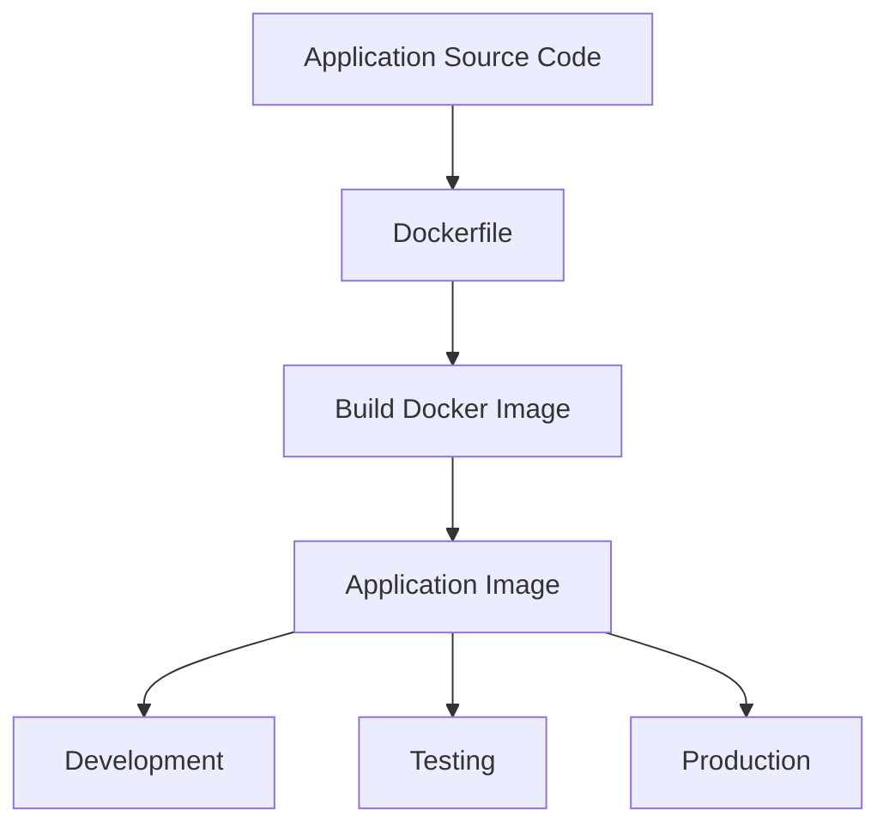
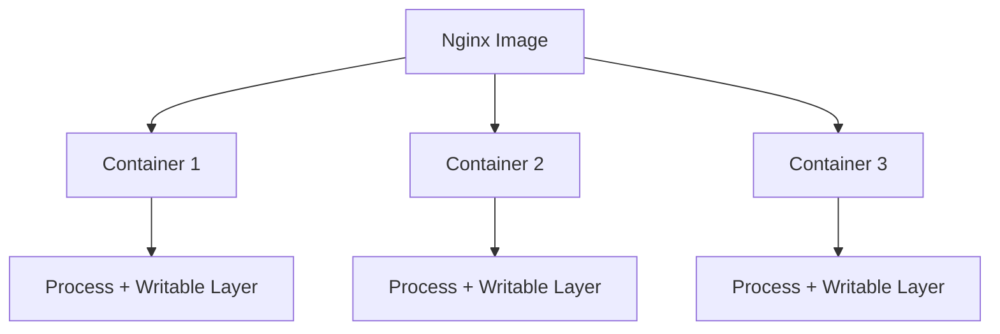
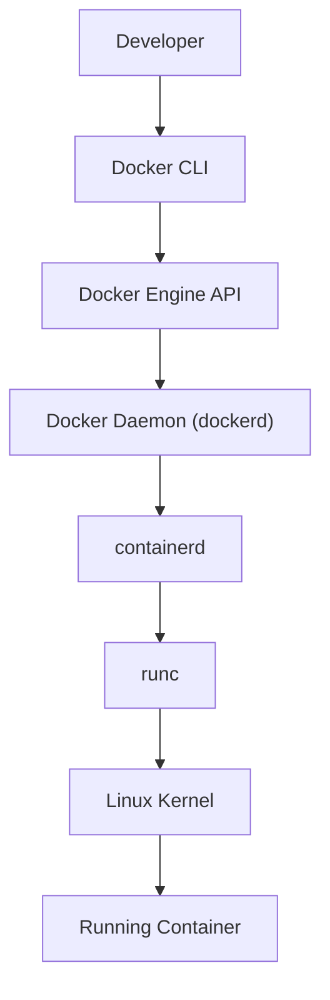
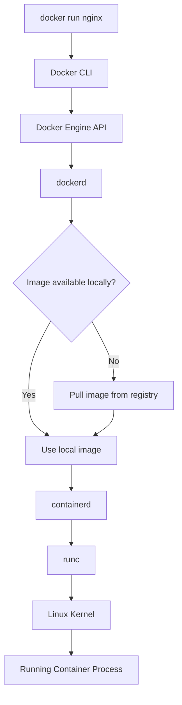

# Docker Internals: Containers, Images, Linux Namespaces and Runtime Architecture

> A beginner-friendly guide to understanding what Docker containers really are, how they work internally, and how Docker creates and manages them.

## Table of Contents

1. [The "Works on My Laptop" Problem](#1-the-works-on-my-laptop-problem)
2. [What Is a Container?](#2-what-is-a-container)
3. [Linux Namespaces: What Can a Process See?](#3-linux-namespaces-what-can-a-process-see)
4. [cgroups: How Much Can a Process Consume?](#4-cgroups-how-much-can-a-process-consume)
5. [Containers Share the Host Kernel](#5-containers-share-the-host-kernel)
6. [Container vs Virtual Machine](#6-container-vs-virtual-machine)
7. [Docker Images vs Containers](#7-docker-images-vs-containers)
8. [Understanding Image Layers](#8-understanding-image-layers)
9. [Independent Writable State](#9-independent-writable-state)
10. [Docker Architecture: Behind the Scenes](#10-docker-architecture-behind-the-scenes)
11. [How Docker Creates a Container](#11-how-docker-creates-a-container)
12. [Production Considerations](#12-production-considerations)
13. [Important Commands](#13-important-commands)
14. [Interview Questions](#14-interview-questions)
15. [Final Revision](#15-final-revision)
16. [Practical Learning Challenge](#16-practical-learning-challenge)

---

# 1. The "Works on My Laptop" Problem

Imagine a developer builds a `payment-service` application.

It works perfectly on their laptop but fails when deployed to a production server.

The code is the same. So why does it fail?

Because the environments are different.

For example:

| Component | Developer Laptop | Production Server |
|---|---|---|
| Node.js | 20.x | 18.x |
| Libraries | Newer versions | Older versions |
| Configuration | Development | Production |
| Environment variables | Available | Missing |
| Installed tools | Different | Different |

An application depends on more than its source code.

It also needs a particular runtime, libraries, configuration, and environment.

### Understanding the application environment

```text
Application Environment
       |
       |-- Application Code
       |-- Runtime (Node.js, Java, etc.)
       |-- Libraries
       |-- Configuration
       |-- Environment Variables
       |-- Required Files
```

If these dependencies are different between environments, the application may behave differently.

This is the reason behind the famous statement:

**"It works on my machine!"**

## How Docker helps

Docker allows us to package an application's code and much of its required environment into an image.

For example, a Node.js application image can contain:

- Application code
- Node.js runtime
- Required libraries
- Configuration defaults
- Required filesystem content
- Startup instructions

We can use the same image in development, testing, and production.



The image provides a consistent starting environment.

**Important:** Docker does not create a separate operating system for every container. It runs processes with isolation and resource controls.

That is the foundation of Docker internals.

---

# 2. What Is a Container?

A **container is one or more processes running with isolation, resource controls, and a configured filesystem environment.**

First, understand what a process is.

A process is simply a running program.

For example:

```bash
node index.js
```

When we execute this command, the operating system starts a Node.js process.

A process has:

- Process ID (PID)
- Memory
- Open files
- Environment variables
- User permissions
- Access to operating-system services

A container is not a separate operating system.

It is a normal process or group of processes running with additional isolation and resource controls.

## 2.1 What makes a process a container?

Several Linux features work together to create a container environment.

```text
CONTAINER
    |
    |-- Application Process
    |
    |-- Namespaces
    |      Provide isolation
    |
    |-- cgroups
    |      Control resource usage
    |
    |-- Filesystem
    |      Provides container files
    |
    |-- Runtime Configuration
           Defines how it runs
```

Each component has a different responsibility.

## 2.2 A container process is still a host process

This is one of the most important Docker concepts.

Even when an application runs inside a container:

- It is still a Linux process.
- The host kernel schedules it.
- It consumes host CPU and memory.
- It can be seen from the host's process table.
- It uses the host kernel for system calls.

The difference is that the process has an isolated view of the system.

### Example: Different PID views

Suppose the same process has these IDs:

| Perspective | PID |
|---|---:|
| Host | 24108 |
| Container | 1 |

```text
Same Process
     |
     |-- Host sees PID 24108
     |
     |-- Container sees PID 1
```

These are two different views of the same process.

**Important:** PID 1 inside a container does not mean Docker created another operating system.

## 2.3 Why is PID 1 important?

PID 1 is the first process in a PID namespace.

It has some special responsibilities:

- Handling signals.
- Reaping orphaned child processes.
- Managing child process termination.

A container can run multiple processes, but generally we design one primary application process per container.

### Quick Check

If an application reports PID 1 inside a container, does that mean it is not a host process?

**Answer:** No. The same process can have PID 1 inside the container and another PID on the host.

---

# 3. Linux Namespaces: What Can a Process See?

Namespaces are a Linux kernel feature.

They provide isolation by giving processes their own views of system resources.

In simple words:

**Namespaces control what a process can see.**

For example, a container does not normally see every process running on the host.

## 3.1 Types of Linux namespaces

Linux provides different namespaces for isolating different resources.

| Namespace | What it isolates | Simple question |
|---|---|---|
| PID | Process IDs and process visibility | Which processes can I see? |
| Mount (MNT) | Filesystem mount points | Which filesystem can I see? |
| Network (NET) | Network interfaces, IPs, and routes | Which network can I see? |
| UTS | Hostname and NIS domain name | Which hostname do I have? |
| IPC | Certain communication resources | Which IPC resources can I access? |
| USER | User and group ID mappings | Which user identity applies? |
| CGROUP | Cgroup hierarchy view | Which cgroup hierarchy can I see? |
| TIME | Certain clock offsets | Which clock offsets apply? |

Not every container must have completely separate namespaces. Docker can also be configured to share namespaces.

## 3.2 PID Namespace

PID stands for Process Identifier.

A PID namespace provides a separate view of process IDs.

Imagine the host has these processes:

```text
HOST
 |
 |-- systemd
 |-- sshd
 |-- dockerd
 |-- nginx container process (PID 24108)
```

Inside the container, the same application may appear as:

```text
CONTAINER
 |
 |-- nginx (PID 1)
```

The container sees its own limited process view.

The host can see the container process along with other host processes.

### Docker PID namespace options

Share the host PID namespace:

```bash
docker run --pid=host ubuntu ps aux
```

Share another container's PID namespace:

```bash
docker run --pid=container:my-container ubuntu ps aux
```

These options change process visibility. They do not create another kernel.

## 3.3 Mount Namespace

A mount namespace provides a separate view of filesystem mount points.

For example:

**Container A:**

```text
/
├── bin
├── etc
├── home
├── tmp
└── app
```

Container B can have a different filesystem view.

This means the root directory `/` inside a container is not automatically the same filesystem view as the host's `/`.

However, Docker allows us to share selected directories using bind mounts.

Example:

```bash
docker run -v /host/data:/app/data nginx
```

Here:

- `/host/data` is the host directory.
- `/app/data` is the directory inside the container.

The container can access the mounted host directory.

**Remember:** Mount namespaces isolate filesystem views, but explicitly shared mounts can expose host files.

## 3.4 Network Namespace

A network namespace provides a separate network environment.

A container can have its own:

- Network interfaces
- IP addresses
- Routing tables
- Network sockets
- Port space

Example:

| Resource | Container A | Container B |
|---|---|---|
| Interface | eth0 | eth0 |
| IP address | 172.18.0.2 | 172.18.0.3 |
| Network namespace | Separate | Separate |

Both containers can listen on port 8080.

Why?

Because they have separate network namespaces.

Traffic reaching those ports depends on Docker networking, port publishing, and routing configuration.

## 3.5 UTS Namespace

UTS stands for Unix Timesharing System.

It isolates:

- Hostname
- NIS domain name

Example:

Container A:

```bash
hostname
```

Output:

```text
payment-service
```

Container B can also have the same hostname.

Having the same hostname does not mean they are the same container.

## 3.6 IPC Namespace

IPC stands for Inter-Process Communication.

It isolates certain communication resources, such as:

- System V IPC objects
- POSIX message queues

This helps prevent processes in different IPC namespaces from accessing each other's IPC resources by default.

## 3.7 USER Namespace

The USER namespace provides separate user and group ID mappings.

For example:

| Perspective | User ID |
|---|---:|
| Inside container | 0 |
| Host mapping | 100000 |

A user can appear as root inside a container while being mapped to a different unprivileged ID on the host.

This is called user namespace remapping.

It can reduce the impact of certain privilege-related risks.

## 3.8 CGROUP Namespace

The CGROUP namespace provides a separate view of the cgroup hierarchy.

Remember:

It does not itself enforce CPU or memory limits.

Resource control is handled by cgroups.

## 3.9 TIME Namespace

The TIME namespace allows certain system clocks to have different offsets.

It is mainly useful for specialized workloads and testing.

### Namespace Summary

```text
PID       -> Which processes can I see?

MOUNT     -> Which filesystem view can I see?

NETWORK   -> Which network environment can I see?

UTS       -> Which hostname do I see?

IPC       -> Which IPC resources can I access?

USER      -> Which user identity mapping applies?

CGROUP    -> Which cgroup hierarchy can I see?

TIME      -> Which clock offsets apply?
```

---

# 4. cgroups: How Much Can a Process Consume?

cgroups stands for **Control Groups**.

They are a Linux kernel feature used to monitor and control resource consumption.

In simple words:

**Namespaces control what a process can see. cgroups control how much it can consume.**

## 4.1 What can cgroups control?

Common resources include:

- CPU
- Memory
- Disk I/O
- Number of processes

Imagine a Linux server has 16 GB RAM.

We run three containers:

| Container | Memory Limit |
|---|---:|
| Node.js | 2 GB |
| Java | 4 GB |
| Nginx | 1 GB |

cgroups can enforce these limits.

## 4.2 Docker memory limit

We can limit a container to 512 MB:

```bash
docker run -d \
  --name memory-test \
  --memory=512m \
  nginx
```

Docker configures the container's resource limits using the underlying Linux resource-control mechanisms.

## 4.3 Docker CPU limit

We can limit a container to approximately one CPU's worth of processing time:

```bash
docker run -d \
  --name cpu-test \
  --cpus=1 \
  nginx
```

## 4.4 Monitor resource usage

Use:

```bash
docker stats
```

This displays live resource usage, including:

- CPU usage
- Memory usage
- Network I/O
- Block I/O
- Process count

## 4.5 What happens when a memory limit is exceeded?

Imagine a container has a memory limit of 512 MB.

Its processes continue consuming memory.

When the cgroup reaches its configured memory limit, the kernel may trigger an Out Of Memory (OOM) event and kill one or more processes.

This does not necessarily mean the entire host has run out of memory.

## 4.6 cgroups v1 vs cgroups v2

Linux provides two major cgroup implementations.

| cgroups v1 | cgroups v2 |
|---|---|
| Older implementation | Modern implementation |
| Separate hierarchies for controllers | Unified hierarchy |
| Different controller interfaces | More consistent resource-control interface |

With cgroups v2, you may find files such as:

| File | Purpose |
|---|---|
| `memory.current` | Current memory usage |
| `memory.max` | Hard memory limit |
| `cpu.max` | CPU bandwidth limit |
| `pids.current` | Current process count |
| `pids.max` | Maximum process count |

### Understanding memory.max

Run:

```bash
cat memory.max
```

Possible output:

```text
max
```

What does this mean?

It means there is no hard memory limit at that particular cgroup level.

It does not mean unlimited RAM.

The process is still affected by:

- Available physical memory.
- Parent cgroup limits.
- Host capacity.
- Other system policies.

### Important: Parent cgroups

cgroups are hierarchical.

For example:

```text
Parent cgroup
    memory.max = 1 GB
          |
          |
    Child cgroup
    memory.max = max
```

Even though the child has `memory.max = max`, the parent still limits the child to the resources available under its hierarchy.

### Namespaces vs cgroups

| Namespaces | cgroups |
|---|---|
| Provide isolation | Provide resource control |
| Control what a process can see | Control what a process can consume |
| Separate process, network, and filesystem views | Limit CPU, memory, and other resources |

**Easy way to remember:**

```text
NAMESPACES -> WHAT CAN I SEE?

CGROUPS    -> HOW MUCH CAN I USE?
```

---

# 5. Containers Share the Host Kernel

The Linux kernel is responsible for:

- Running processes.
- Scheduling CPU time.
- Managing memory.
- Handling system calls.
- Managing filesystems.
- Managing networking.

Normal Linux containers use the host's running Linux kernel.

They do not boot a separate kernel for every container.

## 5.1 Container architecture

```text
         Physical Hardware
                 |
              Linux OS
                 |
             Linux Kernel
            /     |     \
           /      |      \
    Container A  Container B  Container C
         |           |           |
       Node.js      Java        Nginx
```

All three containers use the same Linux kernel.

However, their process environments can be isolated from each other.

## 5.2 What does sharing the kernel mean?

It means:

1. Containers normally start faster than full virtual machines.
2. Containers do not independently boot another Linux kernel.
3. Containers depend on the host kernel's available features.
4. Kernel vulnerabilities can potentially affect container isolation.
5. A fatal host kernel failure can affect all containers using it.

## 5.3 How can we verify the shared kernel?

On the Linux host:

```bash
uname -r
```

Inside a Linux container:

```bash
docker run --rm ubuntu uname -r
```

Normally, both commands show the same kernel release when Docker Engine runs directly on that Linux host.

Example:

```text
Host:      6.x.y-example

Container: 6.x.y-example
```

## 5.4 Image operating system vs host kernel

An image can contain user-space files from different Linux distributions:

- Ubuntu
- Alpine
- Debian
- Fedora

For example:

```text
Linux Host
    |
    |-- Linux Kernel
    |
    |-- Ubuntu Container
    |      |-- Ubuntu user-space files
    |      |-- Application
    |
    |-- Alpine Container
           |-- Alpine user-space files
           |-- Application
```

The Ubuntu and Alpine images provide different user-space environments.

They do not provide separate running kernels to normal Linux containers.

**Important:** Container image operating system files and the host's running kernel are two different things.

---

# 6. Container vs Virtual Machine

A container is not a small virtual machine.

Both provide workload isolation, but they work differently.

A virtual machine normally boots its own guest operating system and kernel.

A normal Linux container shares the host kernel.

| Feature | Container | Virtual Machine |
|---|---|---|
| Main unit | Isolated process or process group | Virtual machine |
| Kernel | Shares Linux host kernel | Has its own guest kernel |
| Startup | Starts processes | Boots an OS |
| Filesystem | Image and mounted filesystems | Virtual disks and filesystems |
| Overhead | Generally lower | Generally higher |

### Container architecture

```text
Physical Hardware
      |
   Linux OS
      |
  Linux Kernel
      |
  ---------------
  |      |      |
  A      B      C
```

### Virtual machine architecture

```text
Physical Hardware
      |
   Hypervisor
      |
  ---------------
  |      |      |
 VM A   VM B   VM C
  |      |      |
 OS     OS     OS
  |      |      |
Kernel Kernel Kernel
```

### Important takeaway

Containers share the host kernel.

Virtual machines normally have their own guest kernels.

Security depends on configuration, privileges, isolation boundaries, and the workload. Do not assume that one model is automatically secure in every situation.

---

# 7. Docker Images vs Containers

This is one of the most important Docker concepts.

**An image is a packaged starting point. A container is a running instance created from that image.**

An image is not a running application.

A container is created using an image.

## 7.1 What is a Docker image?

A Docker image contains the files and instructions needed to start an application.

For example, a Node.js image might contain:

```text
Node.js Runtime
Application Code
Node Modules
Configuration Defaults
Required Files
Startup Instructions
```

A normal Linux image does not contain a separate running Linux kernel.

## 7.2 What is a Docker container?

A container is a runtime instance created from an image.

For example:

```bash
docker run nginx
```

Docker creates and starts a container using the Nginx image.

If the image is not available locally, Docker can pull it from a registry.

General command structure:

```bash
docker run [OPTIONS] IMAGE [COMMAND] [ARG...]
```

## 7.3 What happens when we run the same image multiple times?

Consider these commands:

```bash
docker run -d --name checkout-1 nginx

docker run -d --name checkout-2 nginx

docker run -d --name checkout-3 nginx
```

We now have three separate containers created from the same Nginx image.



Each container has its own:

- Container ID.
- Runtime process or process group.
- Namespace configuration.
- cgroup placement.
- Writable layer.

The image provides the common starting content.

The containers are separate runtime instances.

### Quick Check

If three containers use the same image, are they the same container?

**Answer:** No. They are three separate container instances that share the same starting image content.

---

# 8. Understanding Image Layers

Docker images are made up of read-only filesystem layers and configuration metadata.

Layers allow Docker to reuse unchanged files between images.

## 8.1 Example of image layers

Imagine an application image has these layers:

```text
Application Layer
       |
Runtime Layer
       |
Base Image Layer
```

For example:

```text
Application Code
       |
Node.js Runtime
       |
Ubuntu Base Filesystem
```

This is a simplified conceptual representation.

## 8.2 Why does Docker use layers?

Imagine two applications use the same Ubuntu base image.

Image A:

```text
Application A
Node.js Runtime
Ubuntu Base
```

Image B:

```text
Application B
Node.js Runtime
Ubuntu Base
```

The unchanged base content can be reused instead of storing duplicate copies of the same image content.

Benefits include:

- Reduced storage usage.
- Faster image downloads when layers are already available.
- Reuse of common dependencies.
- More efficient image distribution.

## 8.3 Image tags vs digests

An image reference can look like this:

```text
registry.example.com/myteam/payment-service:1.4
```

It contains:

| Part | Meaning |
|---|---|
| `registry.example.com` | Registry |
| `myteam/payment-service` | Repository |
| `1.4` | Tag |

A tag is a convenient name for an image.

However, a tag can be changed to point to different image content.

A digest identifies specific image content.

Example:

```text
payment-service@sha256:<digest>
```

For production deployments, digest-based references help ensure that the selected image content is precise and reproducible.

---

# 9. Independent Writable State

When Docker creates a container from an image, it adds a writable layer on top of the image's read-only layers.

The container sees these layers as one filesystem.

```text
Container Filesystem
       |
       |-- Writable Layer
       |
       |-- Read-only Image Layers
```

## 9.1 What happens when a container creates a file?

Suppose the image contains:

```text
/app/payment-service
/app/defaults.yaml
/usr/lib/...
```

Container A creates:

```text
/app/runtime/session.db
```

This new file is stored in Container A's writable layer.

It does not modify the original image.

## 9.2 What happens when a container modifies an existing file?

Suppose the image contains:

```text
/app/defaults.yaml = Version A
```

Container A changes it:

```text
/app/defaults.yaml = Version B
```

The container now sees Version B.

The original image still contains Version A.

This is commonly handled through copy-on-write or related storage mechanisms, depending on the storage driver.

## 9.3 Can two containers have different files when using the same image?

Yes.

Imagine:

- Container A uses the Nginx image.
- Container B uses the same Nginx image.
- Container A creates `/app/test.txt`.
- No shared volume or host directory is configured.

Container B will not automatically see that file.

Why?

Because each container has its own writable layer.

```text
              SHARED IMAGE
          defaults.yaml = A
                  |
          -----------------
          |               |
     Container A     Container B
          |               |
     Writable Layer  Writable Layer
          |               |
     Version B        Version A
```

The image layers are shared as read-only starting content.

The writable layers are independent.

**Important:** If containers use explicitly shared volumes or bind mounts, they can access the same data.

## 9.4 Independent state vs persistent state

These are two different concepts.

**Independent state:**

- Belongs to an individual container.
- Is not automatically visible to sibling containers.
- Can disappear when the container is removed.

**Persistent state:**

- Is designed to survive container replacement.
- Uses a separate storage mechanism.
- Needs its own backup and recovery strategy.

### Where should important data live?

Use storage mechanisms such as:

- Docker volumes.
- Bind mounts.
- External databases.
- Managed storage services.

Example:

```bash
docker run -d \
  --name database \
  -v database-data:/var/lib/data \
  my-database-image
```

Here, `database-data` is a Docker volume.

The volume has a different lifecycle from the container's writable layer.

**Remember: Independent does not mean persistent.**

---

# 10. Docker Architecture: Behind the Scenes

Now that we understand images, containers, namespaces, and cgroups, let's see how Docker creates a container.

Docker uses multiple components to handle a container request.

The important components are:

1. Docker CLI
2. Docker Engine API
3. Docker Daemon (`dockerd`)
4. containerd
5. runc
6. Linux Kernel

## 10.1 Architecture diagram



This is a simplified view of the responsibilities and creation flow.

## 10.2 Docker CLI

CLI stands for Command Line Interface.

It is the tool we use to communicate with Docker.

For example:

```bash
docker run nginx
```

The CLI sends our request to Docker Engine through its API.

The Docker Engine can run locally or on another machine.

## 10.3 Docker Engine API

The Docker Engine API provides communication between Docker clients and Docker Engine.

It supports operations such as:

- Creating containers.
- Starting containers.
- Stopping containers.
- Pulling images.
- Managing networks.
- Managing volumes.

The Docker CLI uses this API to communicate with the daemon.

## 10.4 Docker Daemon (dockerd)

`dockerd` is the Docker daemon.

It manages Docker's high-level operations.

Its responsibilities include:

- Container lifecycle management.
- Image management.
- Network management.
- Volume management.
- Coordinating runtime operations.

**Security note:** Access to the Docker daemon is highly privileged in typical installations.

Protect the Docker socket and remote API.

## 10.5 containerd

containerd is a container runtime manager used by Docker.

It handles lower-level container operations and image-related content management.

It coordinates container tasks and their lifecycle.

It does not replace the Linux kernel.

## 10.6 runc

runc is a low-level OCI (Open Container Initiative) runtime.

It uses the runtime configuration to create a container process.

It configures things such as:

- Namespaces.
- cgroups.
- Filesystem mounts.
- User credentials.
- Process settings.

It asks the Linux kernel to create the configured process.

**Important:** runc is not a permanent middle layer between the application and the kernel.

After startup, the application runs directly under kernel control.

## 10.7 Linux Kernel

The Linux kernel actually runs and manages the container processes.

It handles:

- CPU scheduling.
- Memory management.
- Process management.
- System calls.
- Filesystem operations.
- Networking.

The kernel enforces the configured isolation and resource controls.

### Responsibility Summary

| Component | Responsibility |
|---|---|
| Docker CLI | Sends user requests |
| Docker Engine API | Provides communication |
| dockerd | Coordinates Docker operations |
| containerd | Manages lower-level container tasks |
| runc | Creates the OCI-configured process |
| Linux Kernel | Runs and manages the process |

**Easy way to remember:**

```text
Docker CLI
    |
    | Sends request
    |
Docker Daemon
    |
    | Coordinates work
    |
containerd
    |
    | Manages runtime task
    |
runc
    |
    | Creates configured process
    |
Linux Kernel
    |
    | Runs the process
    |
Container Application
```

---

# 11. How Docker Creates a Container

Let's understand what happens when we execute:

```bash
docker run nginx
```

### Step-by-step workflow

**Step 1: Docker CLI receives the command**

We execute:

```bash
docker run nginx
```

**Step 2: Docker CLI communicates with Docker Engine**

The CLI sends a request through the Docker Engine API.

**Step 3: dockerd processes the request**

The daemon checks the request and coordinates the required operations.

**Step 4: Docker checks the image**

If the Nginx image is not available locally, Docker can pull it from the configured registry.

If it is already available, Docker can use the local image.

**Step 5: containerd coordinates runtime operations**

Docker uses containerd to manage the lower-level container task.

**Step 6: runc creates the container process**

runc applies the OCI runtime configuration.

It configures namespaces, mounts, cgroups, and other runtime settings.

**Step 7: Linux kernel runs the process**

The kernel schedules and manages the application process.

### Workflow diagram



### One important thing to understand

The above workflow explains container creation.

After the application starts, its system calls go directly to the Linux kernel.

They do not travel through:

```text
Docker CLI -> dockerd -> containerd -> runc
```

for every application operation.

These components help create and manage the container. The kernel runs the actual process.

---

# 12. Production Considerations

Docker makes application packaging and deployment easier.

However, using Docker does not automatically solve every production problem.

There are four important areas to consider.

## 12.1 Availability

Containers can fail.

If an application runs inside one container on one server, that server is still a single point of failure.

Production systems need:

- Health checks.
- Restart strategies.
- Redundancy.
- Orchestration where appropriate.

## 12.2 Security

Containers can still have security problems.

For example:

- Vulnerable images.
- Excessive privileges.
- Exposed credentials.
- Dangerous host mounts.
- Insecure network access.

Container security requires proper configuration and multiple layers of protection.

## 12.3 Persistence

Important application data should not exist only in a container's writable layer.

If the container is removed, that data can disappear.

Use persistent storage such as volumes, external databases, or managed storage services.

## 12.4 Monitoring

Containers also need monitoring.

Important areas include:

- Logs.
- Metrics.
- Traces.
- Alerts.
- Health checks.

Docker does not replace monitoring and observability.

### Production Mental Model

```text
AVAILABILITY
    |
    |-- Containers and servers can fail

SECURITY
    |
    |-- Vulnerabilities and excessive privileges remain risks

PERSISTENCE
    |
    |-- Writable container data can disappear

MONITORING
    |
    |-- Logs, metrics and alerts are still required
```

## 12.5 Separate application, configuration, and data

A good production design separates different responsibilities.

| Component | Responsibility |
|---|---|
| Image | Application and its dependencies |
| Configuration | Environment-specific settings |
| Secrets | Passwords, tokens, and credentials |
| Persistent storage | Data that must survive replacement |
| Writable layer | Temporary container-specific changes |

For example, manually installing a new library inside one running container does not update the original image.

Other containers will not automatically receive that change.

The better approach is:

1. Update the application or Dockerfile.
2. Build a new image.
3. Test the image.
4. Push it to a registry.
5. Deploy the new image.

This keeps deployments consistent and repeatable.

---

# 13. Important Commands

## Docker commands

| Command | Purpose |
|---|---|
| `docker ps` | List running containers |
| `docker ps -a` | List all containers |
| `docker run nginx` | Create and start a container |
| `docker inspect <container>` | Inspect container configuration |
| `docker top <container>` | View container processes |
| `docker stats` | Monitor resource usage |
| `docker logs <container>` | View container logs |
| `docker exec -it <container> sh` | Open a shell inside a running container |
| `docker restart <container>` | Restart a container |
| `docker stop <container>` | Stop a container |
| `docker rm <container>` | Remove a stopped container |
| `docker image ls` | List local images |
| `docker image inspect <image>` | Inspect image details |

## Linux commands

| Command | Purpose |
|---|---|
| `uname -r` | Display kernel release |
| `ps aux` | Display running processes |
| `ps -eo pid,ppid,user,comm,args` | Display detailed process information |
| `lsns` | List Linux namespaces |
| `lsns -p <PID>` | Inspect namespaces for a process |
| `ls -l /proc/<PID>/ns/` | View namespace links |
| `readlink /proc/<PID>/ns/*` | Read namespace identifiers |
| `cat /proc/<PID>/cgroup` | Inspect cgroup membership |

**Important:** Linux `/proc` and cgroup commands must be run against the Linux system that actually hosts the container processes.

Docker Desktop uses a managed Linux environment for Linux containers.

---

# 14. Interview Questions

Try answering these questions without referring to the notes.

## Container Fundamentals

1. What is a container?
2. Why does Docker solve the "works on my machine" problem?
3. Why is a container considered an isolated process rather than a lightweight VM?
4. Can a container run multiple processes?
5. Can a container process have different PIDs inside and outside the container?
6. Why is PID 1 important?

## Linux Namespaces and cgroups

7. What are Linux namespaces?
8. What are the different types of Linux namespaces?
9. What is the difference between PID and network namespaces?
10. How does a mount namespace provide filesystem isolation?
11. What is the purpose of a USER namespace?
12. What are cgroups?
13. What is the difference between namespaces and cgroups?
14. How does Docker enforce memory limits?
15. What does `memory.max = max` mean?
16. Why should we inspect parent cgroups?
17. What is the difference between cgroups v1 and v2?

## Images and Containers

18. What is a Docker image?
19. What is the difference between an image and a container?
20. What happens when you run the same image three times?
21. Why does Docker use image layers?
22. What happens when a container modifies a file from an image layer?
23. If two containers use the same image, can their files differ?
24. What is the difference between a writable layer and persistent storage?
25. What is the difference between an image tag and digest?

## Docker Architecture

26. What is the responsibility of Docker CLI?
27. What does dockerd do?
28. What is containerd?
29. What is runc?
30. Which component actually schedules container processes?
31. Does every application system call pass through runc?
32. Can Docker CLI and Docker daemon run on different machines?

## Production and Troubleshooting

33. Why is storing important data in a writable container layer risky?
34. Why is access to the Docker daemon sensitive?
35. Does Docker automatically solve availability?
36. What are the important security considerations when running containers?
37. Why should configuration and secrets be separated from the application image?

---

# 15. Final Revision

| Concept | Key Takeaway |
|---|---|
| Environment | Applications depend on runtime, libraries, and configuration |
| Container | One or more isolated processes |
| PID | A container process still has a host-visible PID |
| PID namespace | Provides a separate process ID view |
| Mount namespace | Provides a separate filesystem mount view |
| Network namespace | Provides a separate network environment |
| UTS namespace | Isolates hostname and NIS domain name |
| IPC namespace | Isolates certain communication resources |
| USER namespace | Provides user and group ID mappings |
| cgroup namespace | Provides a separate cgroup hierarchy view |
| TIME namespace | Provides certain clock offsets |
| cgroups | Control resource consumption |
| Shared kernel | Normal Linux containers use the host kernel |
| Image | Packaged starting content and metadata |
| Container | Runtime instance created from an image |
| Image layers | Reusable read-only filesystem content |
| Writable layer | Container-specific writable state |
| Persistent storage | Data designed to survive container replacement |
| Docker CLI | Sends requests to Docker Engine |
| dockerd | Coordinates Docker operations |
| containerd | Manages lower-level container tasks |
| runc | Creates the configured container process |
| Linux kernel | Runs and manages the process |

## Five Important Mental Models

Remember these five statements:

**1. A container is a process, not a separate operating system.**

**2. Namespaces control what a process can see.**

**3. cgroups control and account for what a process can consume.**

**4. An image provides the starting content; a container is a runtime instance with its own writable state.**

**5. Docker components create and manage containers, but the Linux kernel actually runs the processes.**

---

# 16. Practical Learning Challenge

Theory is important, but understanding what happens underneath Docker is even more important.

Let's imagine we need to run three temporary instances of `checkout-service` on a Linux server.

### Requirements

- Use one application image.
- Create three independent containers.
- Do not install the application's runtime directly on the host.
- Verify that each container has a separate runtime identity.
- Verify that writable state is independent.
- Identify the host-side process.
- Understand which kernel runs the containers.

### Evidence to collect

| Requirement | What to verify |
|---|---|
| Same starting artifact | Image reference |
| Three runtime instances | Container IDs |
| Separate processes | Host process information |
| Different PID views | Host and container PIDs |
| Independent writable state | Create a file in one container and check the others |
| Shared kernel | Compare host and container kernel release |
| Namespace membership | Inspect `/proc/<PID>/ns/` |
| cgroup membership | Inspect `/proc/<PID>/cgroup` |

### Important things to remember

- Different container names do not prove that processes have separate kernels.
- Matching hostnames do not mean two containers are the same.
- A Docker dashboard showing `Running` does not prove that a container has its own kernel.
- The actual Linux host provides the evidence needed to understand container internals.

**Your goal is not just to run containers. Your goal is to understand what Docker creates underneath.**

---

## Next: Docker Container Lifecycle

After understanding these fundamentals, the next topic is Docker container lifecycle.

We will cover:

1. Container creation and startup.
2. Container lifecycle states.
3. Foreground vs detached mode.
4. Container naming.
5. `docker run` vs `docker start`.
6. `docker exec` vs `docker attach`.
7. Logs and exit codes.
8. Restart policies.
9. Container stop and removal.
10. Troubleshooting stopped and exited containers.
